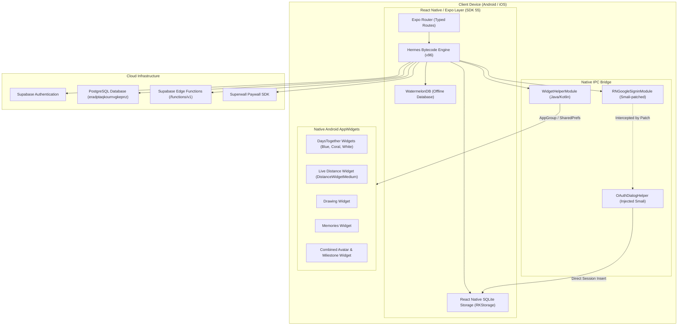

# Lovio Master Knowledge Base & Technical Encyclopedia

> **Repository**: `lovio-src`  
> **Package Identifier**: `com.fourplex.lovio` (Android) / `com.datemateai.app` (iOS)  
> **App Name**: Lovio (Couples App & Widgets)  
> **Version**: 2.2.0 (v25) to 2.2.3  
> **Framework**: Expo SDK 55 (React Native New Architecture) + Native Android Kotlin/Java Widgets  
> **Backend**: Supabase (`eradptaqkournvgkepnz.supabase.co`)  

---

## Table of Contents
1. [Executive Summary & Purpose](#1-executive-summary--purpose)
2. [Master Architecture & Technology Stack](#2-master-architecture--technology-stack)
3. [Cloud, API & Security Credentials Catalog](#3-cloud-api--security-credentials-catalog)
4. [Reverse Engineering & Custom Modifications](#4-reverse-engineering--custom-modifications)
   - [4.1 Premium Paywall Bypass](#41-premium-paywall-bypass)
   - [4.2 Google Sign-In / OAuth Resigning Bypass](#42-google-sign-in--oauth-resigning-bypass)
   - [4.3 Direct SQLite Session Injection (`catalystLocalStorage`)](#43-direct-sqlite-session-injection-catalystlocalstorage)
   - [4.4 Standalone APK vs Split APK Reassembly](#44-standalone-apk-vs-split-apk-reassembly)
5. [Native Android Widget System](#5-native-android-widget-system)
6. [Web Authenticator Helper](#6-web-authenticator-helper)
7. [Build, Sign & Emulation Manual](#7-build-sign--emulation-manual)
8. [Inventory of Gathered Assets](#8-inventory-of-gathered-assets)
9. [Documentation Index & Links](#9-documentation-index--links)

---

## 1. Executive Summary & Purpose

**Lovio** is a mobile relationship platform designed for couples. It pairs two partner devices to share interactive home screen widgets, live distance tracking, shared photo memories, anniversary countdowns, and synchronized sketch doodles.

This repository (`lovio-src`) serves as the **consolidated master project folder** containing all artifacts collected from the filesystem:
- The original untouched APK/XAPK distribution.
- Complete decompiled Java/Kotlin source code (`sources/`).
- Android assets, resources, and Hermes JS bundle (`resources/`).
- Disassembled Smali workspace (`apktool-workspace/`).
- All reverse-engineered and signed APK builds (`apks/`).
- Build and signing tools (`build-tools/apktool.jar`, `build-tools/debug.keystore`).
- Android Virtual Device configurations and emulator launch scripts (`emulator/`).
- Web reconnaissance and OAuth interception tools (`reconnaissance/`, `web_authenticator/`).

---

## 2. Master Architecture & Technology Stack



### Core Components:
- **Expo SDK 55.0.0**: React Native with New Architecture enabled (`newArchEnabled: true`).
- **Hermes Bytecode Engine**: Ahead-of-time compiled JavaScript (`resources/assets/index.android.bundle`).
- **WatermelonDB**: High-performance SQLite-backed reactive client database (`@lovesworking/watermelondb-expo-plugin-sdk-52-plus`).
- **Supabase**: Backend-as-a-Service providing Auth, PostgreSQL database, and Deno Edge Functions.
- **Superwall**: Commercial in-app paywall management SDK.
- **Native Android AppWidgets**: 9 distinct widget providers implemented in Kotlin and Java with custom canvas rendering.
- **PairIP Licensing Check**: Google Play Integrity anti-tamper framework (`com.pairip.licensecheck`).

---

## 3. Cloud, API & Security Credentials Catalog

The following production credentials were extracted from `assets/app.config`:

| Service / Resource | Key / URL / ID | Usage |
|---|---|---|
| **Supabase Base URL** | `https://eradptaqkournvgkepnz.supabase.co` | Main backend API & database endpoint |
| **Supabase Functions** | `https://eradptaqkournvgkepnz.supabase.co/functions/v1` | Deno edge functions base URL |
| **Supabase Reference ID** | `eradptaqkournvgkepnz` | Project database tenant ID |
| **Supabase Public Anon Key** | `<REDACTED_SUPABASE_ANON_KEY>` | Public JWT token for client queries |
| **Superwall Android API Key** | `<REDACTED_SUPERWALL_ANDROID_KEY>` | Paywall authorization on Android |
| **Superwall iOS API Key** | `<REDACTED_SUPERWALL_IOS_KEY>` | Paywall authorization on iOS |
| **Google OAuth Web Client ID** | `991844407748-4shbovgk8jvveus7khaqt6pf4d0ag0k9.apps.googleusercontent.com` | Google Sign-In web authentication |
| **Google OAuth iOS Client ID** | `991844407748-j26t8otq7st637squrbjs3kk6japto0g.apps.googleusercontent.com` | Google Sign-In iOS client ID |
| **EAS Project ID** | `154a4f97-722e-4a6e-a01b-5f3c463e5171` | Expo Application Services cloud project |
| **Apple Team ID** | `3GZ7B6M75G` | Apple Developer Team identifier |
| **iOS Bundle Identifier** | `com.datemateai.app` | iOS Bundle ID |
| **App Group Identifier** | `group.datemateai.app` | Shared storage container for iOS widgets |
| **Universal Link Host** | `getlovio.app` (`pathPrefix: /invite`) | Invitation links and universal routing |
| **Custom URI Scheme** | `datemate-ai-v2://` | Internal deep linking scheme |

---

## 4. Reverse Engineering & Custom Modifications

### 4.1 Premium Paywall Bypass
The official release features strict subscription checks gating widget types, photo galleries, and theme customizations.

**Discovery**: In `assets/app.config`, the Expo runtime reads environment variables defined under `extra`.
**Exploit**: By injecting two developer flags into `assets/app.config`, all paywalls are bypassed without touching Hermes bytecode:
```json
{
  "EXPO_PUBLIC_NATIVE_STORE_OFFERS_ENABLED": "false",
  "EXPO_PUBLIC_SKIP_SUBSCRIPTION_CHECK": "true",
  "EXPO_PUBLIC_FREE_PREMIUM_MODE": "true"
}
```
**Output Package**: `apks/builds/premium-unlocked/lovio-premium-unlocked.apk`.

---

### 4.2 Google Sign-In / OAuth Resigning Bypass
**Problem**: Resigning the APK with `debug.keystore` alters the certificate fingerprint (SHA-1: `83:38:18:9E:...`), causing Google Play Services to reject OAuth requests with error `10: DEVELOPER_ERROR`.

**Solution**:
1. Injected a custom class `com.fourplex.lovio.OAuthDialogHelper` into `smali_classes8`.
2. Patched `com.reactnativegooglesignin.RNGoogleSigninModule.smali` so calls to `signIn` invoke:
   ```smali
   invoke-static {p1, p2}, Lcom/fourplex/lovio/OAuthDialogHelper;->showAuthDialog(Landroid/app/Activity;Lcom/facebook/react/bridge/Promise;)V
   ```
3. When invoked, the app displays an `AlertDialog` allowing the user to paste a valid Supabase token or OAuth URL from `web_authenticator/index.html`.

---

### 4.3 Direct SQLite Session Injection (`catalystLocalStorage`)
When an authentication token is provided to `OAuthDialogHelper`, it bypasses network authentication entirely and writes the session directly into React Native's underlying SQLite database:
- **Database Path**: `/data/data/com.fourplex.lovio/databases/RKStorage`
- **Table**: `catalystLocalStorage`
- **Key**: `sb-eradptaqkournvgkepnz-auth-token`
- **Value**: Formatted JSON matching Supabase Auth session schema (access token, refresh token, user ID, user metadata).
- **Result**: The React Native promise resolves successfully, immediately unlocking the authenticated home screen.

**Output Package**: `apks/builds/oauth-dialog/lovio-dialog-signed.apk`.

---

### 4.4 Standalone APK vs Split APK Reassembly
- The Play Store / APKPure distribution was an **XAPK** consisting of:
  - `com.fourplex.lovio.apk` (base)
  - `config.arm64_v8a.apk` (ARM64 native libraries)
  - `config.mdpi.apk` (graphic resources)
- Recompiled and merged packages are stored in `apks/builds/` as complete, standalone APKs installable with a single `adb install` command.

---

## 5. Native Android Widget System

The native layer (`sources/com/fourplex/lovio`) features specialized widgets communicating via `WidgetHelperModule`:

| Widget Provider Class | Layout File | Description |
|---|---|---|
| `DaysTogetherBlueWidget` | `widget_days_together_blue.xml` | Days together milestone counter in soft blue theme |
| `DaysTogetherCoralWidget` | `widget_days_together_coral.xml` | Days together milestone counter in romantic coral theme |
| `DaysTogetherWhiteWidget` | `widget_days_together_white.xml` | Minimalist monochrome days together counter |
| `DaysTogetherCountdownWidget` | `widget_days_together_countdown.xml` | Countdown timer to next milestone/anniversary |
| `DaysTogetherLockSmallWidget` | `widget_days_together_lock_small.xml` | Compact widget optimized for lock screens |
| `DistanceWidgetMedium` | `widget_distance_medium.xml` | Real-time distance between partners rendered via dynamic canvas bitmap (`DistanceWidgetBitmapRenderer`) |
| `DrawingWidget` | `widget_drawing.xml` | Canvas rendering shared doodle notes from partner |
| `MemoriesWidget` | `widget_memories.xml` | Photo carousel of couple's memories |
| `CombinedWidget` | `widget_combined.xml` | Multi-info widget displaying avatar pair, days together, and distance |

---

## 6. Web Authenticator Helper

Located at [`web_authenticator/index.html`](file:///home/habib-ullah/Downloads/lovio-src/web_authenticator/index.html):
- Standalone HTML5/JS tool with Supabase JS SDK.
- Intercepts Supabase OAuth callbacks, parses hash tokens (`access_token`, `refresh_token`), and extracts JWT claims.
- Dispatches parsed tokens back to the mobile app using the deep-link URL `datemate-ai-v2://`.

---

## 7. Build, Sign & Emulation Manual

### Rebuilding & Signing from Source:
```bash
# 1. Build APK from disassembled workspace
java -jar build-tools/apktool.jar b apktool-workspace -o apks/builds/my-build.apk

# 2. 4-byte page align
zipalign -p -f -v 4 apks/builds/my-build.apk apks/builds/my-build-aligned.apk

# 3. Sign using bundled debug keystore
apksigner sign \
  --ks build-tools/debug.keystore \
  --ks-pass pass:android \
  --ks-key-alias androiddebugkey \
  --key-pass pass:android \
  --out apks/builds/my-build-signed.apk \
  apks/builds/my-build-aligned.apk
```

### Running on Android Emulator:
```bash
# Launch pre-configured Lovio AVD (Camera passthrough enabled)
./emulator/run_emulator.sh lovio_emulator

# Install and launch
adb install -r apks/builds/oauth-dialog/lovio-dialog-signed.apk
adb shell monkey -p com.fourplex.lovio -c android.intent.category.LAUNCHER 1
```

### Keystore Specifications:
- **Path**: `build-tools/debug.keystore`
- **Keystore Type**: PKCS12
- **Password**: `android`
- **Alias**: `androiddebugkey`
- **SHA-1**: `83:38:18:9E:D6:45:08:C7:8E:DA:C9:35:69:A0:0D:FC:44:8D:93:48`
- **SHA-256**: `58:3B:1F:19:B0:57:1C:41:CA:89:FD:9D:80:BC:83:39:66:89:2E:C8:22:F4:E7:21:01:C4:DA:45:2E:FC:D6:AC`

---

## 8. Inventory of Gathered Assets

| Directory | Item Count | Key Contents |
|---|---|---|
| `apks/original/` | 1 XAPK, 3 Splits | Original APKPure download & split APKs |
| `apks/builds/premium-unlocked/` | 4 files | Paywall bypassed APKs (`lovio-premium-unlocked.apk`) |
| `apks/builds/oauth-dialog/` | 4 files | OAuth dialog & session injection APKs (`lovio-dialog-signed.apk`) |
| `apks/builds/full-standalone/` | 4 files | Standalone merged builds (`lovio-full-signed.apk`) |
| `apks/builds/base-app/` | 4 files | Base recompiled APKs (`lovio-app-signed.apk`) |
| `apks/builds/splits-signed/` | 5 files | Individual signed ARM64 and mdpi splits |
| `apktool-workspace/` | Full disassembly | Smali classes 1-8, AndroidManifest.xml, assets, layouts |
| `build-tools/` | 2 files | `apktool.jar` & `debug.keystore` |
| `emulator/` | 6 files | `run_emulator.sh`, `window_dump.xml`, AVD config files |
| `reconnaissance/` | 1 file | `wappalyzer_getlovio-app.csv` (Web scan of `getlovio.app`) |
| `web_authenticator/` | 1 file | `index.html` (OAuth proxy & session injector) |
| `sources/` | 34 Java files | JADX decompiled Java/Kotlin source code for `com.fourplex.lovio` |
| `resources/` | Full assets | `app.config`, Hermes bytecode `index.android.bundle`, res |
| `knowledge/` | 6 documents | Detailed technical sub-guides |

---

## 9. Documentation Index & Links

For specialized deep-dives, see the modular guides in [`knowledge/`](file:///home/habib-ullah/Downloads/lovio-src/knowledge/):
- [**System Architecture & Tech Stack**](file:///home/habib-ullah/Downloads/lovio-src/knowledge/ARCHITECTURE.md)
- [**Reverse Engineering, Mods & Paywall Bypass**](file:///home/habib-ullah/Downloads/lovio-src/knowledge/REVERSE_ENGINEERING_AND_MODS.md)
- [**Authentication, Supabase & Cloud Credentials**](file:///home/habib-ullah/Downloads/lovio-src/knowledge/AUTHENTICATION_AND_SUPABASE.md)
- [**Widgets & Native Modules Reference**](file:///home/habib-ullah/Downloads/lovio-src/knowledge/WIDGETS_AND_NATIVE_MODULES.md)
- [**Build, Signing & Emulator Operations Guide**](file:///home/habib-ullah/Downloads/lovio-src/knowledge/BUILD_SIGNING_AND_EMULATOR.md)
- [**Granular Directory Inventory**](file:///home/habib-ullah/Downloads/lovio-src/knowledge/DIRECTORY_INVENTORY.md)
