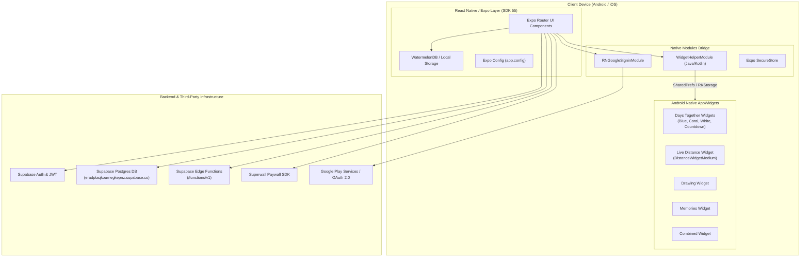

# Lovio Architecture & System Overview

## 1. Executive Summary
**Lovio** (internally identified as `datemate-ai-v2`, Android package `com.fourplex.lovio`, iOS bundle `com.datemateai.app`) is a couples-oriented mobile application and widget platform. It provides shared home screen widgets, relationship milestones, anniversary counters, live real-time distance tracking, shared drawings, questions, and memories.

The app is built on a hybrid architecture combining a high-performance **React Native** frontend powered by **Expo SDK 55** (with React Native's New Architecture enabled) and a native Android AppWidget layer written in **Kotlin** and **Java**.

---

## 2. High-Level System Architecture

---

## 3. Technology Stack & Frameworks

| Layer | Component | Version / Identifier | Description |
|---|---|---|---|
| **Framework** | Expo SDK | `55.0.0` | React Native cross-platform application framework |
| **Runtime** | Hermes JS Engine | Bytecode v96 (`index.android.bundle`) | High-performance ahead-of-time compiled JavaScript engine |
| **Architecture** | React Native New Architecture | `newArchEnabled: true` | Fabric Renderer & TurboModules |
| **Routing** | Expo Router | Modern file-based routing | Typed routes enabled |
| **Local Database** | WatermelonDB | `@lovesworking/watermelondb-expo-plugin-sdk-52-plus` | High-performance reactive offline SQLite database |
| **Local Key-Value** | React Native SQLite Storage | Database: `RKStorage` Table: `catalystLocalStorage` | Underlying storage for React Native AsyncStorage & Supabase sessions |
| **Backend & API** | Supabase | Project ID: `eradptaqkournvgkepnz` | PostgreSQL, Auth, Realtime database, and Edge Functions |
| **Monetization** | Superwall | Superwall SDK | In-app paywalls and subscription management |
| **In-App Billing** | Google Play Billing / StoreKit | `com.android.vending.BILLING` | Native subscription handling |
| **Native Android** | Android AppWidgets | Android API 26 (min) to 36 (target) | Native interactive home screen widgets |
| **Anti-Tamper** | PairIP App Licensing | `com.pairip.licensecheck` | Google Play integrity & licensing verification framework |

---

## 4. Key Identifiers & Configuration

- **App Display Name**: Lovio
- **Slug**: `lovio`
- **Internal Scheme**: `datemate-ai-v2`
- **Android Package**: `com.fourplex.lovio`
- **iOS Bundle Identifier**: `com.datemateai.app`
- **EAS Project ID**: `154a4f97-722e-4a6e-a01b-5f3c463e5171`
- **Associated Web Domain**: `https://getlovio.app`
- **Deep Link Patterns**:
  - `datemate-ai-v2://*`
  - `https://getlovio.app/invite*`
- **Supported Locales**: English (`en`), French (`fr`), Korean (`ko`), German (`de`), Spanish (`es`).

---

## 5. Security & Permission Profile

The Android implementation requests extensive hardware and background access to support couples' real-time synchronization:

- **Location Tracking**:
  - `android.permission.ACCESS_FINE_LOCATION` & `android.permission.ACCESS_COARSE_LOCATION`
  - Used for the Live Distance Widget and local date spot recommendations.
- **Background Operations**:
  - `android.permission.WAKE_LOCK`, `android.permission.RECEIVE_BOOT_COMPLETED`, `android.permission.FOREGROUND_SERVICE`
  - Used to schedule widget timeline updates and location broadcasts.
- **Media & Camera**:
  - `android.permission.CAMERA`, `android.permission.READ_EXTERNAL_STORAGE`, `android.permission.WRITE_EXTERNAL_STORAGE`
  - Used for avatar photos, memory galleries, and shared drawing widgets.
- **Audio**:
  - `android.permission.RECORD_AUDIO`
  - Used for voice notes and shared audio moments between partners.
